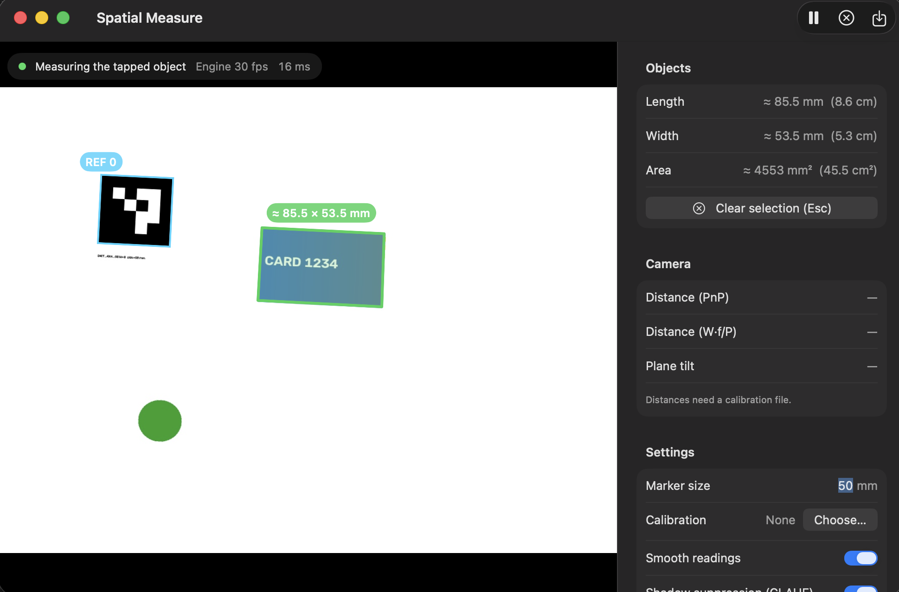
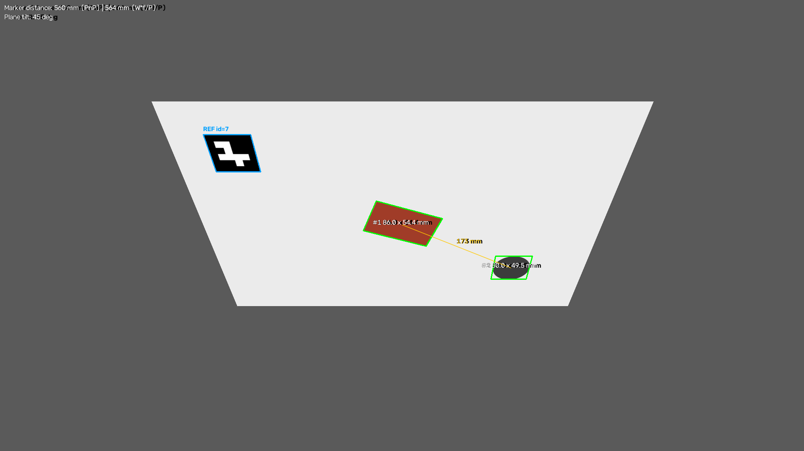
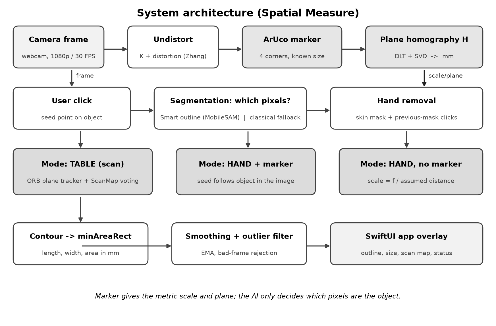

# Spatial Measure: Real-Time Spatial Distance and Object Dimension Estimation

Measure the real size of an object, in millimetres, with one ordinary webcam. Click an object in the live view and the
app outlines it and reports its length, width and area, plus the camera distance and the tilt of the surface. The scale
comes from a printed 50 mm ArUco marker whose four corners give a planar homography (tilted view → top-down view in mm);
a pretrained segmentation model (MobileSAM) decides which pixels belong to the clicked object.

**Team (Dept. of Computer Science and Engineering (AIML), Karunya Institute of Technology and Sciences):**
Joel Prasad (URK24CS7019) · Nevin Reji (URK24CS7004) · Prince Amos (URK24CS7024)

🛠 **How to run (Windows / macOS / Linux):** [HOW_TO_RUN.txt](HOW_TO_RUN.txt)  
📄 **Project report:** [docs/Spatial_Measure_Project_Report.pdf](docs/Spatial_Measure_Project_Report.pdf)  
🎬 **Video demonstration:** [youtu.be/2LbJO3nAttc](https://youtu.be/2LbJO3nAttc)

| App: tap to measure | Pipeline output, plane tilted 45° |
|---|---|
|  |  |



```
frame → undistort (K, dist) → detect ArUco → homography (DLT) → top-down warp
      → CLAHE(L) + Canny + closing → contours → Otsu edge refinement → minAreaRect → px→mm → overlay
                                       └→ solvePnP / W·f/P → camera-to-marker distance
```

## Results (rendered test scenes with known ground truth)

| Tilt | Card measured (true 85.60 × 53.98 mm) | PnP distance / true |
|---|---|---|
| 0° | 86.2 × 54.4 mm | 639 / 637 mm |
| 25° | 86.2 × 54.5 mm | 593 / 592 mm |
| 45° | 86.0 × 54.4 mm | 560 / 560 mm |

- Size error ≈ 1 % up to 900 mm, ≈ 3 % at 1.5 m; PnP distance within 0.2 % at any tilt up to 60°.
- All 13 automated tests pass (`python -m pytest`).
- A trial with a physical camera has not been recorded yet, so no real-world accuracy is claimed.

## Setup

macOS / Linux:

```bash
python3 -m venv .venv && source .venv/bin/activate
pip install -r requirements.txt
python -m pytest            # synthetic end-to-end tests, no camera needed
```

Windows (PowerShell or Command Prompt, Python 3.10+ from python.org):

```bat
py -3 -m venv .venv
.venv\Scripts\activate
pip install -r requirements.txt
python -m pytest
```

## Desktop app — Windows, macOS and Linux

```bash
python app.py                # live webcam
python app.py --source photo.jpg   # or a still image / video file
```

On Windows you can simply double-click **`run_windows.bat`**: the first run creates `.venv` and installs the
requirements, later runs open the app straight away. The app has the same features as the macOS app below (tap to
measure, *Table* / *Hand + marker* / *Hand, no marker* modes, Smart outline, scanning large objects, benchmark log);
it runs the same engine in-process (`engine_server.Engine` on a worker thread), shows the camera at its full frame
rate and always measures the newest frame. Click an object to measure it, Esc clears, Ctrl+L logs (⌘L on a Mac),
Ctrl+P pauses. On Windows the camera is opened through DirectShow with MJPG, which opens quickly and gives 30 fps
at 1080p on most webcams; if the camera list shows the wrong device, pick another index in *Settings*. Windows asks
for camera permission under *Settings › Privacy & security › Camera › Let desktop apps access your camera*.
Smart outline uses an NVIDIA GPU (CUDA) when PyTorch has one, Apple's GPU on a Mac, otherwise the CPU.

**Settings are remembered.** The marker size, calibration file, mode, camera and toggles are saved to
`settings.json` in the project folder as soon as you change them and are restored on the next start, so the
printed marker is measured and entered only once per computer. `measure.py` uses the saved marker size and
calibration as its defaults too (flags still override them). `settings.json` is not committed, because each
teammate's printer and camera differ; the calibration path is stored relative to the project folder when it is
inside it.

## macOS app (native)

```bash
./macapp/build.sh && open "build/Spatial Measure.app"      # needs only the Xcode Command Line Tools
```

A native SwiftUI window: the camera is shown through `AVCaptureVideoPreviewLayer`, so video runs at the
camera's full frame rate on the GPU and never waits for OpenCV. Frames are streamed to `engine_server.py`
(the same Python pipeline) only when it is idle — late frames are dropped, never queued — and results are drawn
as a vector overlay. A sidebar shows live sizes, spacing, distance and tilt, holds the settings (marker size,
calibration file, smoothing, CLAHE, edge refinement) and logs benchmark rows (⌘L). Readings are smoothed by
tracking each object across frames. The app runs the engine from this folder's `.venv`, so rebuild if you move
the project. First launch asks for camera permission.

**Tap to measure:** click any object in the video. It is outlined and its length, width and area are shown as
estimates (≈); the reading follows the object while it stays put, and Esc (or the ✕ button) clears it. The
marker must be in view when you tap, because it is what gives the scale.

**Object in your hand:** switch the sidebar to *In my hand*, hold the printed marker next to the object (same distance
from the camera, facing it) and click the object. It is followed as you move and turn it, fingers are ignored, and a
single bad frame is filtered out. The scale comes from the marker, so the object and marker must be at the same
depth; if one is closer to the lens than the other, its size reads too large or too small.

**Object in your hand, no marker:** pick *Hand, no marker*, set the distance from the camera to the object (measure it
once with a ruler and hold the object there), and click the object. The scale is `f / distance`, with the focal length
`f` taken from the calibration file or, without one, from the camera's field of view (default 65°, adjustable).
It is an estimate: the error in the size equals the error in the distance (25 % too far reads 25 % too big).

**Smart outline (AI):** on by default in the app. The outline of the clicked object comes from MobileSAM, a distilled
Segment Anything model pre-trained on SA-1B (11 M images, 1.1 B masks), via `ultralytics` (`pip install ultralytics`;
weights download once to `models/`). It only decides *which pixels are the object*; the metric geometry is unchanged.
Previous-frame mask points are fed back as extra clicks so it stays on the same object. ~70 ms per frame on an M-series
Mac. If it is unavailable the app falls back to the classical outline automatically.

**How well does it track only the object?** `evaluate_tracking.py` clicks the first object of each DAVIS-2017 sequence and
follows it, scoring every frame against the ground-truth masks. On the first 6 sequences × 30 frames:

| Outline | mean J (IoU) | on-object | tracked (J ≥ 0.5) |
|---|---|---|---|
| Classical (colour flood fill + edges) | 0.05 | 38 % | 0 % |
| Classical, best of a 12-setting grid search | 0.09 | – | 3 % |
| MobileSAM (Smart outline) | 0.40 | 62 % | 36 % |

DAVIS is much harder than a hand-held object on a desk (fast, small, partly occluded, multi-part targets such as a
rider plus bike), and "on-object" counts the share of the mask that lies on the object. The classical outline works on
plain backgrounds but not on natural scenes; no model was fine-tuned here.

**Objects bigger than the frame:** with *Scan large objects* on (default), keep the camera moving along the
object after tapping it. Once the marker leaves the view the app follows the table surface with ORB features
(`spatial_measure/scan.py`), accumulates the object's outline on the marker plane, and shows `≥ L × W` (orange)
until both ends have been seen, then `≈ L × W`. A small map in the sidebar shows what has been scanned. It needs a
table with some texture, a flat object, and slow movement; drift grows the longer the marker is out of view, so
pass by the marker again to re-anchor.

## Workflow

1. **Print targets** — `python generate_targets.py` → `targets/` (50 mm ArUco marker + 9×6 checkerboard
   with 25 mm squares). Print at 100 % / actual size, then **measure the printed marker with a ruler**.
2. **Calibrate** — `python calibrate.py --camera 0` (SPACE to capture 15–30 tilted views, C to finish),
   or `python calibrate.py --images "calib/*.jpg"`. Writes `calibration.npz`; aim for RMS < 0.5 px.
3. **Measure** — `python measure.py --source 0 --calib calibration.npz --marker-mm 50`.
   Lay the marker flat next to the objects. Keys: `W` rectified view, `E` edge view, `S` log, `Q` quit.
   Works on an image too: `--source photo.jpg --output annotated.jpg`. Calibration is optional for
   dimensions (the homography handles perspective) but needed for undistortion and camera distance.
4. **Benchmark (paper §5)** — measure each object with a caliper, then press `S` several times per object:
   ```bash
   python measure.py --source 0 --calib calibration.npz --label "Credit card" --truth 85.60x53.98
   python measure.py --source 0 --calib calibration.npz --truth-distance 600   # marker at 600 mm
   python evaluate.py measurements.csv     # prints the §5.1 / §5.2 tables in Markdown
   ```

## Layout

| File | Purpose |
|---|---|
| `spatial_measure/estimator.py` | Core pipeline (`SpatialDimensionEstimator`, `draw_overlay`) |
| `macapp/` | Native macOS app (SwiftUI + AVFoundation); `build.sh` produces `build/Spatial Measure.app` |
| `app.py` | Cross-platform desktop app (Windows, macOS, Linux; Tkinter) |
| `run_windows.bat` | Windows launcher: sets up `.venv` on first run, then starts `app.py` |
| `engine_server.py` | Measurement engine: the macOS app talks to it over stdin/stdout, `app.py` runs it in-process |
| `spatial_measure/settings.py` | Saved settings (`settings.json`) shared by `app.py` and `measure.py` |
| `measure.py` | OpenCV-window version: webcam / video / image measurement + CSV logging |
| `calibrate.py` | Checkerboard calibration (Zhang's method) |
| `generate_targets.py` | Print-ready marker and checkerboard PDFs |
| `evaluate.py` | Accuracy tables from logged measurements |
| `tests/test_synthetic.py` | Renders a known scene through a known camera pose and checks the outputs |

## Differences from the paper's listing (§4.2)

- The listing computes `H` but never warps the frame with it, and maps the whole scene into a 300 px
  marker-sized square. Here the marker defines the mm scale and the canvas is sized to cover the frame.
- Undistortion uses cached remap tables (needed for 30 FPS) and `alpha=0` instead of cropping the ROI,
  which would shift the principal point used for distance estimation.
- Adaptive threshold → Canny produced double edges; replaced with CLAHE on LAB L-channel (§6.1 mitigation)
  → Canny → closing.
- Canny contours sit 1–2 px outside the true edge, inflating every measurement; each contour is re-located
  at the local Otsu threshold (falls back to Canny if the object isn't a clean blob).
- The reference marker and any sheet/mat it lies on are excluded from the measured objects.
- `D = W·f/P` is only valid when the marker faces the camera; `solvePnP` (IPPE square) is reported alongside it
  and also gives plane tilt (warns above 65°, §7).

## Limits

Objects must be flat and on the marker's plane — the top face of a 30 mm-tall box is closer to the camera and
reads larger (§7 "non-planar depth variances"). Glare, hard shadows and motion blur break contours (§6).
